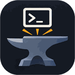

<p align="center"></p>

# appforge

Menú de consola que centraliza recetas de configuración repetibles: cada opción es un
fichero TOML que instala y configura una aplicación (ejemplos incluidos: Ollama bajo
demanda y fuentes adicionales). Para **Debian 13**.

> AppForge no es un sandbox: cada receta es código que se ejecuta como `root`.
> Revisa las que no hayas escrito antes de aplicarlas.

## 🚀 Uso

Descarga `appforge-<versión>-linux-x86_64.tar.gz` de
[Releases](https://github.com/isidro-rodriguez/appforge/releases) y extráelo en `/opt`:

```bash
sudo tar -xzf appforge-<versión>-linux-x86_64.tar.gz -C /opt
sudo /opt/appforge/appforge                 # TUI: espacio marca, i instala, d dry-run, v detalle
/opt/appforge/appforge validate --strict    # revisa las recetas (sin sudo)
```

Todo queda en `/opt/appforge/`: el programa, `config.toml`, las recetas de ejemplo en
`appforge-entries/`, las tuyas en `custom-entries/` y el registro en `logs/`. Para
actualizar sin perder tus cambios: `sudo /opt/appforge/appforge update`.

## 📚 Documentación

**[Web de la documentación](https://isidro-rodriguez.github.io/appforge/)**: guía de
uso, uso avanzado y cómo crear recetas.

## 🧑‍💻 Desarrollo

Con [uv](https://docs.astral.sh/uv/):

```bash
git clone https://github.com/isidro-rodriguez/appforge.git
cd appforge
uv sync
uv run ruff format . && uv run ruff check . && uv run ty check && uv run pytest
uv run python scripts/build.py             # binario, config y entradas en dist/ (.tar.gz)
```

Más en [Contribuir](https://isidro-rodriguez.github.io/appforge/desarrollo/contribuir/),
[CLAUDE.md](CLAUDE.md) y, para nuevas recetas, [AGENTS.md](AGENTS.md).

## Licencia

[MIT](LICENSE).
