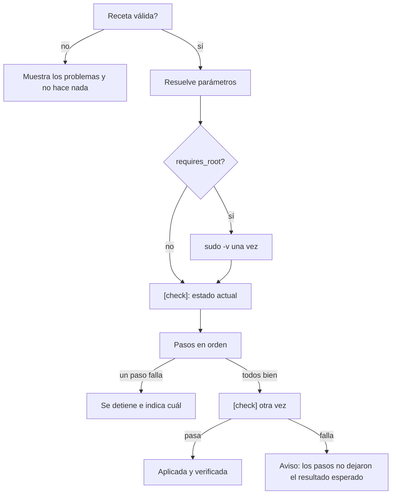

# Qué pasa al aplicar una receta

## Flujo



1. Si la receta tiene problemas de validación, se muestran y no se hace nada.
2. Cada parámetro toma el valor dado o su `default`; si falta alguno, error.
3. Si la receta necesita root, `sudo -v` pide la contraseña **una vez**. La TUI se
   suspende mientras tanto.
4. `[check]` informa del estado actual.
5. Los pasos se ejecutan en orden. El primero que falla detiene la receta.
6. `[check]` se repite: si sigue fallando, AppForge avisa de que la receta no dejó el
   resultado esperado.

Una receta detenida a medias puede volver a aplicarse: los pasos están pensados para
repetirse (ver [buenas prácticas](../desarrollo/buenas-practicas.md)).

## Privilegios

| Situación | Comportamiento |
|---|---|
| Usuario normal y `requires_root = true` | Cada paso con `sudo -n`, tras un `sudo -v` inicial |
| Ya eres root | Sin prefijo |
| `[check]` | **Siempre sin root**: pintar el catálogo nunca pide contraseña |
| Credencial de sudo en caché | No vuelve a preguntar |

## Parámetros y secretos

- Nunca se guardan. Solo existen en un fichero temporal `0600` que se borra al
  terminar el paso.
- Ese fichero lleva los `export` y el código del paso, así los valores **no aparecen
  en `ps`** (no van en la línea de comandos) y sobreviven a la limpieza de entorno
  de `sudo`.
- Los valores de los parámetros `secret = true` se sustituyen por `••••••` en toda la
  salida: pantalla, registro y diffs del *dry-run*.

## Ficheros (`template` y `copy`)

| Caso | Acción |
|---|---|
| El destino no existe | Se crea con sus directorios (`install -D`) y el modo indicado |
| Contenido idéntico | «sin cambios»: no se reescribe ni se copia; solo se reaplica el modo |
| Contenido distinto | Copia del original en `backups/<id>/<fecha>/<ruta>` y se escribe |
| No legible sin root | Se lee con `sudo` si la receta es de root |

Para recuperar un fichero, cópialo desde `~/.local/state/appforge/backups/`.

## Dry-run

- `run`, `script` y `[remove]` se **muestran**, no se ejecutan. `#` delante indica
  que irían con root; `$`, sin root.
- `template` y `copy` calculan el contenido final y muestran un **diff** contra el
  destino actual.
- `[check]` **sí** se ejecuta (por eso debe ser de solo lectura).
- No pide contraseña.

## Cancelación

++ctrl+c++ en la pantalla de progreso termina el comando en curso **y todo lo que
haya lanzado**, y no empieza más pasos ni recetas.

Para conseguirlo, cada paso corre en un subshell con su propio grupo de procesos;
bash no atiende una señal mientras espera a un comando, pero `wait` sí:

```bash
set -m                                  # grupo de procesos propio
( <código del paso> ) &
trap 'kill -TERM -- "-$hijo"' TERM INT
wait "$hijo"
```

Con root, la señal va a `sudo`, que la reenvía al comando. Como ante un fallo, una
receta cancelada puede quedar a medias.

## Registro

Cada evento de la TUI y de la CLI se añade a `~/.local/state/appforge/logs/appforge.log`
con fecha, nivel e id de la receta:

```text
2026-10-29 18:10:03 INFO       ollama [tpl ] [4/7] Variables de entorno (optimización)
2026-10-29 18:10:03 INFO       ollama [tpl ] crear /opt/ollama/ollama.env (modo 0644, 276 bytes)
2026-10-29 18:10:04 WARNING    docker [run ] Pasos completados, pero [check] sigue fallando
```

El fichero rota a medianoche y se guardan 7 días. En la TUI, ++l++ lo abre.
