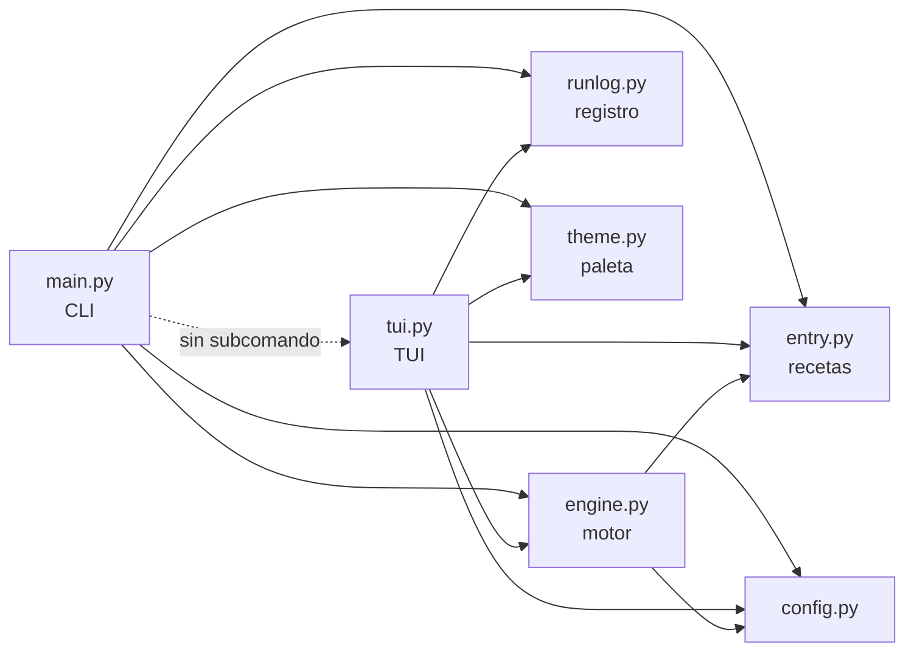

# Arquitectura

## Módulos

| Módulo | Responsabilidad |
|---|---|
| `config.py` | Directorio base y `config.toml` (incluida la tabla `[ui]`) |
| `entry.py` | Carga y valida recetas. **Nunca lanza excepción**: acumula `problems` |
| `engine.py` | Ejecuta `[check]`, pasos y `[remove]`: sudo, copias, *dry-run*, cancelación |
| `runlog.py` | Registro en fichero con rotación diaria (`acodo.logger`) |
| `theme.py` | Paleta sacada del icono; temas de Textual y de Rich |
| `main.py` | CLI (`argparse` + Rich). Sin subcomando carga la TUI de forma perezosa |
| `tui.py` | Catálogo, página de detalle, diálogos y pantalla de progreso |

La referencia de cada función está en la [API](api.md).

## El motor no imprime

`Engine` emite eventos `sink(kind, text)` y cada interfaz los pinta a su manera:

| `kind` | Significado | CLI | TUI |
|---|---|---|---|
| `step` | Empieza un paso | `==> [i/n] título` | `[run ] id: [i/n] título` |
| `out` | Salida de un comando o línea de diff | `  │ …` | `[run ] …` |
| `info` | Información (estado, ficheros) | atenuado | atenuado |
| `ok` / `warn` / `error` | Resultado | `✔` / `!` / `✘` | ídem, en color |

Además, `Engine.on_step(i, total, step)` avisa antes de cada paso (la barra de
progreso) y `Engine.cancel()` se puede llamar desde otro hilo.

## Invariantes

- El estado solo se deriva de `[check]`. No hay fichero de estado.
- Los parámetros nunca se guardan: viajan a bash en un temporal `0600` con `export`.
- Los secretos se enmascaran en todos los eventos.
- `[check]` siempre sin privilegios y con los valores por defecto.
- Antes de sobrescribir un fichero se copia a `backups_dir`.
- Cuatro tipos de paso y nada más: sin condicionales, bucles ni dependencias entre
  recetas. La lógica compleja va en un `script`.

## TUI

| Clase | Qué es |
|---|---|
| `AppForgeApp` | Pantalla principal: catálogo, detalle lateral, selección |
| `AppRow` / `CategoryRow` | Filas de la lista y de las categorías |
| `DetailScreen` | Página de detalle (`entry_markdown()` → `Markdown`) |
| `ParamsScreen` / `ConfirmScreen` | Diálogos previos a ejecutar |
| `ProgressScreen` | Ejecuta un `Plan` en un hilo y muestra progreso y registro |
| `LogScreen` | Registro completo |

Los atajos del catálogo están en `_MAIN_ACTIONS` y solo actúan en la pantalla
principal. Los `[check]` se ejecutan en un hilo y repintan las filas al terminar;
una fila puede recibir su estado antes de haberse montado y lo pinta al montarse.

## Tema

Los colores viven solo en `theme.py`. La TUI usa las variables del tema de Textual
(`$accent`, `$primary`…) o `STYLES`; la CLI, los estilos `af.*` de Rich; esta web,
los mismos valores en `docs/assets/stylesheets/appforge.css`.

| Nombre | Color | Origen en el icono | Uso |
|---|---|---|---|
| `BACKGROUND` | `#14171b` | Fondo exterior | Fondo |
| `SURFACE` | `#1a202b` | Tarjeta | Diálogos |
| `PANEL` | `#1d232f` | Tarjeta, zona clara | Fondo de la barra |
| `CREAM` | `#f8f0e5` | Terminal | Texto |
| `SPARK` | `#fea31d` | Chispas | Títulos de panel, teclas, pasos, avisos |
| `PRIMARY` | `#6a85b0` | Yunque, aclarado | Bordes con foco, barra |
| `ANVIL` · `ANVIL_DARK` · `ANVIL_DEEP` | `#546278` · `#37496a` · `#222e46` | Yunque | Bordes sin foco, cursor, casillas |
| `MUTED` | `#8a94a6` | Derivado | Texto secundario |
| `SUCCESS` · `ERROR` | `#7cc47f` · `#e5604d` | Añadidos para contraste | Correcto · error |
