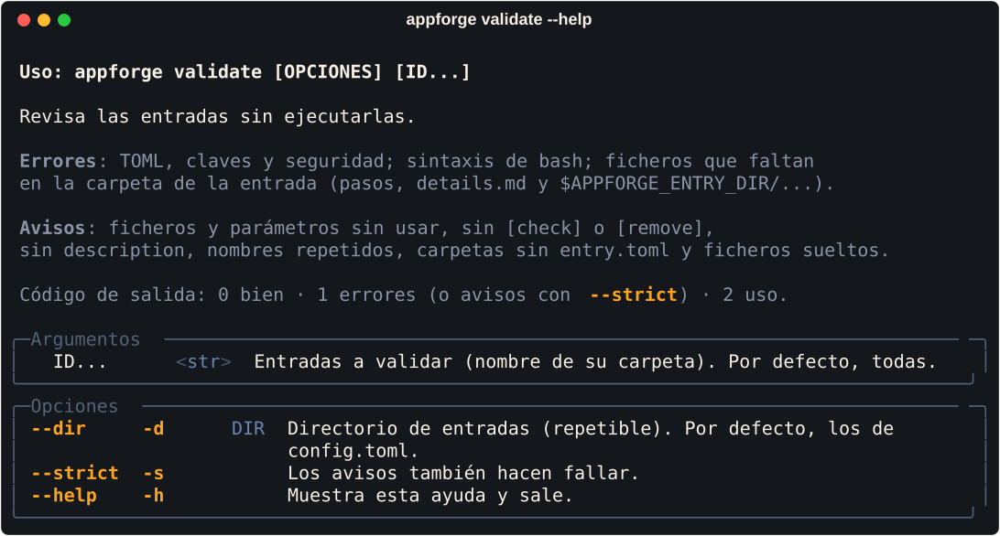
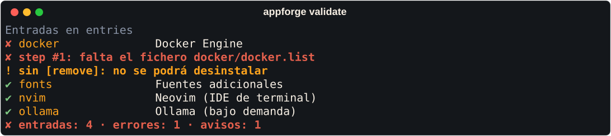

# Línea de comandos

Todo lo interactivo (ver el catálogo, instalar, desinstalar, *dry-run*) se hace en la
[TUI](interfaz.md), que también funciona en cualquier consola. La línea de comandos
solo tiene lo que no cabe en ella:

| Comando | Qué hace | `sudo` | Código de salida |
|---|---|---|---|
| `appforge` | Abre la TUI | sí | 0 · 2 sin superusuario, sin terminal o `config.toml` inválido |
| `appforge validate [ID...]` | Revisa las recetas sin ejecutarlas | no | 0 bien · 1 errores · 2 uso |
| `appforge update` | Actualiza AppForge sin perder tus cambios | sí (no con `--dry-run`) | 0 bien o ya al día · 1 error · 2 uso |
| `appforge --version`, `-V` | Versión | no | 0 |
| `appforge --help`, `-h` | Ayuda (también `appforge validate -h`) | no | 0 |

`ID` es el nombre de la carpeta de la receta (`ollama` para `appforge-entries/ollama/`).

{ .af-shot }

## `appforge validate`

Revisa todas las recetas (o las indicadas) **sin ejecutar nada**: solo lee los
ficheros y comprueba la sintaxis con `bash -n`, así que **no necesita `sudo`**. Úsalo al escribir una receta o en la
CI de tu repositorio de recetas.

| Opción | Efecto |
|---|---|
| `-d`, `--dir DIR` | Valida ese directorio de recetas en lugar de los de `config.toml` (repetible) |
| `-s`, `--strict` | Los avisos también hacen fallar (código 1) |

**Errores** (la receta no se puede aplicar o fallaría):

| Comprobación | Ejemplo de mensaje |
|---|---|
| TOML, claves y tipos | `step #2: necesita exactamente uno de run, template, copy, script` |
| Seguridad (permisos, propietario, enlaces) | `entries/x/entry.toml: escribible por grupo u otros` |
| Ficheros de los pasos | `step #3: falta el fichero ollama/ollama.png` |
| Plantillas | `step #4: la plantilla usa parámetros inexistentes: port` |
| Sintaxis de bash en `run`, `[check]`, `[remove]` y scripts | `step #2: error de sintaxis: …` |
| Referencias `$APPFORGE_ENTRY_DIR/<fichero>` | `[remove]: usa $APPFORGE_ENTRY_DIR/borra.sh, pero no existe x/borra.sh` |

**Avisos** (se puede aplicar, pero algo sobra o falta):

| Comprobación | Ejemplo de mensaje |
|---|---|
| Ficheros de la carpeta que nada usa | `fichero sin usar: x/viejo.conf` |
| Parámetros que ningún comando ni plantilla usa | `parámetro sin usar: port` |
| Sin `description`, `[check]` o `[remove]` | `sin [check]: su estado siempre será desconocido` |
| Dos recetas con el mismo `name` | `nombre repetido en 2 entradas: Docker` |
| Carpeta sin `entry.toml` | `custom-entries/docker/: carpeta sin entry.toml` |
| Fichero suelto, p. ej. una receta en el formato anterior (`<id>.toml`), que se ignora | `custom-entries/mia.toml: formato anterior, se ignora; muévelo a mia/entry.toml…` |
| Receta sustituida por otra con el mismo nombre en un directorio posterior | `ollama: custom-entries/ollama/ sustituye a appforge-entries/ollama/` |

```bash
appforge validate                      # todas
appforge validate ollama fonts         # solo esas
appforge validate --strict             # en la CI: sin errores ni avisos
appforge validate -d ~/mis-recetas     # otro directorio
```

{ .af-shot }

La línea de comandos usa los colores de AppForge en una terminal y respeta
`NO_COLOR`. Los errores de uso van a la salida de error.

## `appforge update`

Actualiza la instalación de `/opt/appforge` **sin perder lo que hayas cambiado**:

```bash
sudo /opt/appforge/appforge update --dry-run   # qué haría (no necesita sudo)
sudo /opt/appforge/appforge update             # hazlo
```

1. Consulta la última versión publicada en GitHub. Si ya la tienes, termina.
2. Descarga el paquete y su `SHA256SUMS`, y comprueba la suma. Si no coincide, no
   instala nada.
3. Compara cada fichero con el manifiesto del paquete (la suma de cada fichero tal
   como se instaló) para saber cuáles cambiaste:

| Fichero | Qué hace |
|---|---|
| Del paquete y sin tocar | Lo sustituye por el nuevo |
| Del paquete y modificado por ti (p. ej. `config.toml`) | **Lo conserva**; si la versión nueva también lo cambia, la deja al lado como `<fichero>.new` para que compares |
| Del paquete y borrado por ti | No lo vuelve a crear |
| Nuevo en el paquete | Lo añade |
| Que el paquete ya no trae | Lo borra si no lo tocaste; si lo tocaste, lo conserva |
| `custom-entries/`, `logs/` y cualquier fichero tuyo | No los toca |

El programa se sustituye el último: si algo falla antes, sigue funcionando la versión
anterior.

| Opción | Efecto |
|---|---|
| `--from FICHERO` | Usa un `.tar.gz` local en lugar de descargarlo. Si junto a él hay un `SHA256SUMS`, lo verifica |
| `-n`, `--dry-run` | Muestra el plan sin cambiar nada |
| `--force` | Instala aunque sea la misma versión o una anterior |

Tras actualizar, revisa los `.new` que haya dejado (`find /opt/appforge -name '*.new'`),
lleva a tu fichero lo que quieras de cada uno y bórralos.
