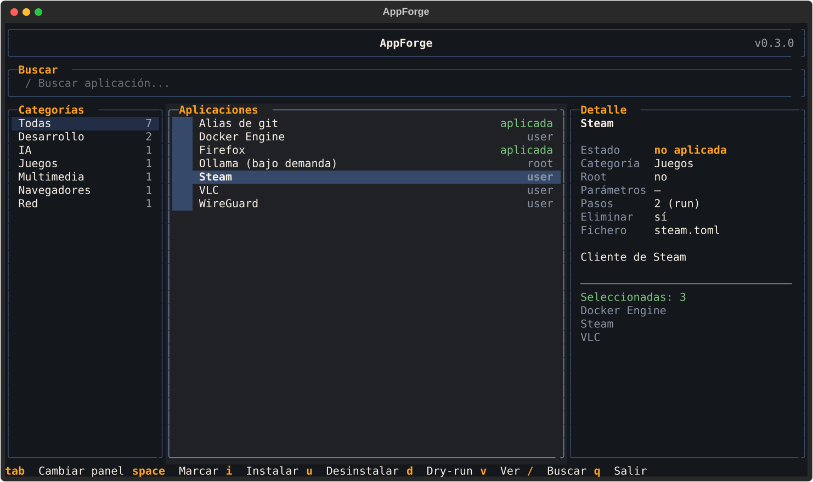
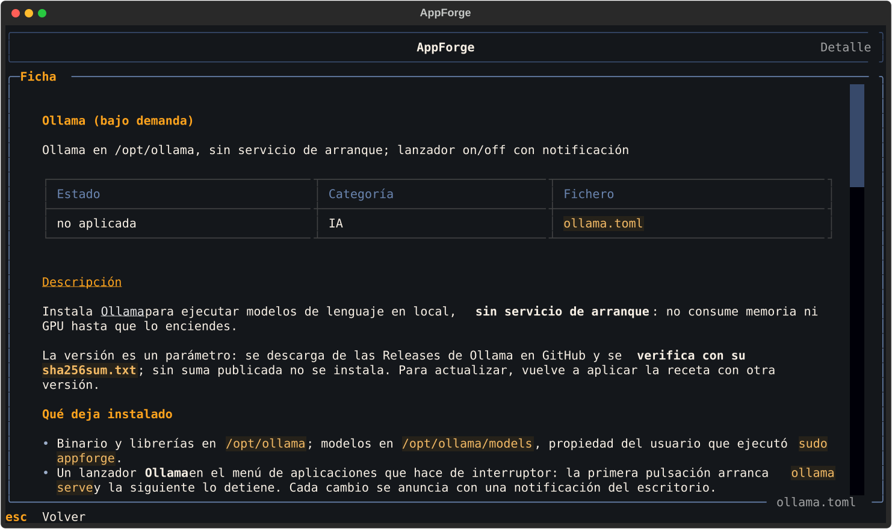
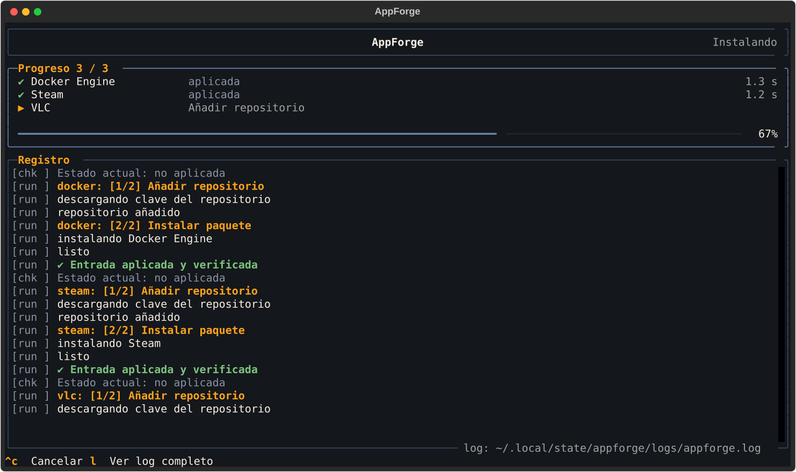

# Interfaz

## Catálogo

<figure class="af-shot" markdown>

<figcaption>Con <code>[ui] search</code> y <code>categories</code> activados en <code>config.toml</code>.</figcaption>
</figure>

| Panel | Contenido |
|---|---|
| **Buscar** | Filtra por nombre, id, descripción y categoría mientras escribes. Opcional: [`[ui] search`](../avanzado/configuracion.md#interfaz) |
| **Categorías** | `Todas` y una fila por categoría, con contador. Las recetas sin `category` van a «Sin categoría». Opcional: [`[ui] categories`](../avanzado/configuracion.md#interfaz) |
| **Aplicaciones** | Casilla de selección, nombre y etiqueta de estado (`aplicada`, `·` no aplicada, `inválida`) |
| **Detalle** | Resumen de la receta resaltada, sus problemas si los tiene y la lista de seleccionadas |

### Teclas

| Tecla | Acción |
|---|---|
| ++space++ / ++enter++ | Marcar o desmarcar la receta resaltada |
| ++i++ | Instalar las marcadas (o la resaltada si no hay ninguna) |
| ++u++ | Desinstalar (`[remove]`) las marcadas o la resaltada |
| ++d++ | *Dry-run* de instalación; no consume la selección |
| ++v++ / doble clic | Abrir la [página de detalle](#página-de-detalle) |
| ++slash++ | Ir al buscador (++esc++ o ++enter++ vuelve a la lista) |
| ++tab++ | Cambiar de panel |
| ++r++ | Recargar recetas desde disco |
| ++q++ | Salir |

Con el ratón, un clic resalta una fila y el doble clic abre su detalle.

## Página de detalle

<figure class="af-shot" markdown>

</figure>

Muestra la receta entera: estado, categoría, la descripción larga
([`details.md`](../desarrollo/formato.md)), los parámetros con sus
valores por defecto (los secretos nunca), cada paso con su comando o fichero de
destino, la comprobación y la eliminación. ++esc++, ++q++ o ++v++ vuelven.

## Antes de ejecutar

1. **Parámetros**: una ventana por receta que los tenga. ++enter++ pasa al siguiente
   campo; en el último, acepta. ++esc++ cancela todo el lote. Si un parámetro tiene
   enlace (↗, p. ej. a las versiones publicadas), aparece bajo su pregunta para consultarlo
   antes de elegir.
2. **Confirmación** (no en *dry-run*): lista de lo que se va a hacer. ++y++ / ++s++
   para sí, ++n++ / ++esc++ para no.

## Progreso

<figure class="af-shot" markdown>

</figure>

| Zona | Contenido |
|---|---|
| **Progreso** `i / N` | Una fila por receta: `▶` en curso, `✔` bien, `✘` falló, `!` cancelada; paso actual y duración |
| Barra | Pasos completados de todo el lote |
| **Registro** | Salida en vivo. Cada línea lleva el tipo de paso: `[run ]`, `[scr ]`, `[tpl ]`, `[copy]`, `[rm  ]`, `[chk ]` |

| Tecla | Acción |
|---|---|
| ++ctrl+c++ | Cancelar: termina el comando en curso y no empieza más pasos ni recetas |
| ++l++ | Ver el registro completo (también ejecuciones anteriores) |
| ++esc++ | Volver al catálogo, cuando ha terminado |

Si una receta falla, el lote continúa con la siguiente. Las que terminan bien se
desmarcan del catálogo.
