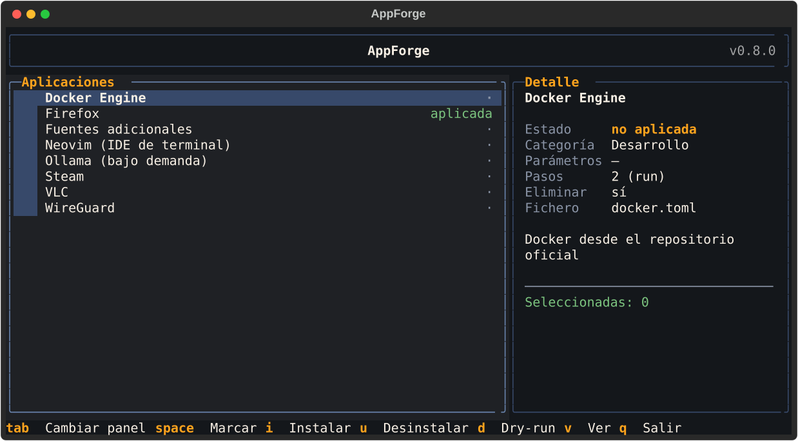
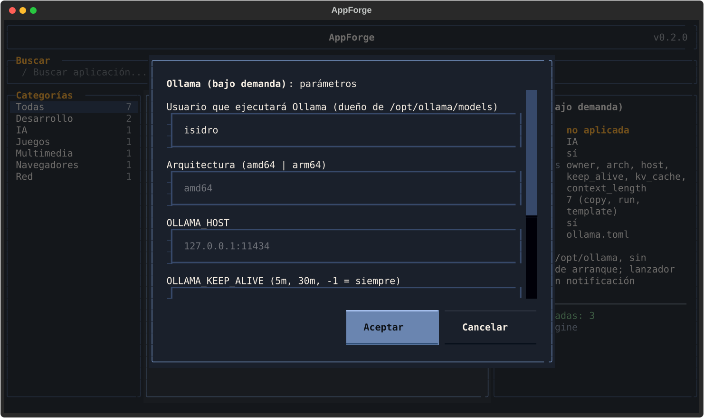
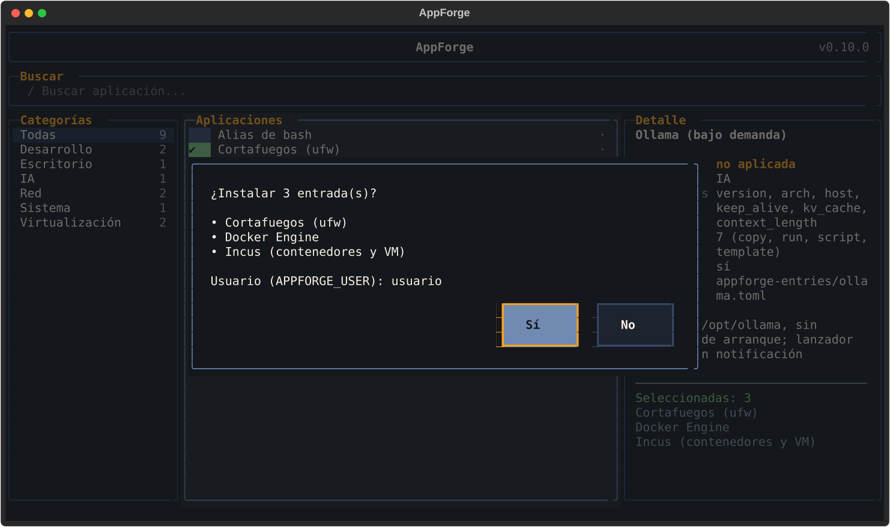
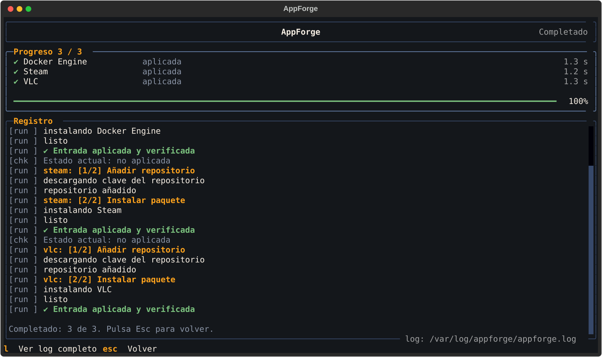

# Primeros pasos

## 1. Descarga y extrae

Descarga `appforge-<versión>-linux-x86_64.tar.gz` de
[Releases](https://github.com/isidro-rodriguez/appforge/releases) y extráelo en `/opt`:

```bash
sudo tar -xzf appforge-<versión>-linux-x86_64.tar.gz -C /opt
```

Todo AppForge queda en una carpeta:

```text
/opt/appforge/
├── appforge            # el programa
├── config.toml         # configuración
├── appforge-entries/   # recetas de ejemplo
├── custom-entries/     # tus recetas
└── logs/               # registro de ejecuciones (se crea al usarlo)
```

Las [recetas de ejemplo](recetas.md) son
eso, ejemplos: úsalas, cámbialas o bórralas. [Las tuyas](../desarrollo/nueva-entrada.md)
van en `custom-entries/`. Para actualizar AppForge más adelante basta
`sudo /opt/appforge/appforge update`: conserva lo que hayas cambiado
([detalles](cli.md#appforge-update)).

Para comprobar que el paquete procede del proyecto, mira
[Seguridad](../avanzado/seguridad.md#verificar-el-paquete).

## 2. Abre el catálogo

AppForge solo funciona como superusuario:

```bash
sudo /opt/appforge/appforge
```

Si prefieres escribir solo `sudo appforge`, enlázalo en tu `PATH`:

```bash
sudo ln -s /opt/appforge/appforge /usr/local/bin/appforge
```

El resto del recorrido usa la receta de Ollama. Ningún paso cambia nada en tu sistema
hasta el de instalar, y ese es opcional.

<figure class="af-shot" markdown>

<figcaption>Vista por defecto: lista de recetas y ficha de la resaltada.</figcaption>
</figure>

Cada fila tiene una **casilla** de selección, el nombre y una etiqueta:

| Etiqueta | Significado |
|---|---|
| `aplicada` | Su comprobación (`[check]`) pasa: ya está en tu sistema |
| `·` | No aplicada |
| `…` | Comprobando |
| `inválida` | La receta tiene errores; la ficha dice cuáles |

Muévete con las flechas. La ficha de la derecha resume la receta resaltada.

## 3. Lee la receta completa

Haz **doble clic** sobre *Ollama* o pulsa ++v++.

<figure class="af-shot" markdown>

<figcaption>La ficha completa: descripción, parámetros, cada paso, comprobación y eliminación.</figcaption>
</figure>

Es lo mismo que hay en el TOML, pero legible. ++esc++ vuelve al catálogo.

## 4. Prueba sin tocar nada

Pulsa ++d++ (*dry-run*). AppForge te pide los parámetros de la receta:

<figure class="af-shot" markdown>

<figcaption>Los campos vacíos usan el valor por defecto que se ve en gris.</figcaption>
</figure>

Cambia el valor que quieras (vacío = el de por defecto) y acepta. Bajo la versión
aparece un enlace (↗) a las versiones publicadas por el proyecto. La pantalla de progreso enseña cada
comando que se ejecutaría (precedido de `#`) y el **diff** de cada fichero
que se escribiría. Al terminar, ++esc++ vuelve al catálogo.

## 5. Instala por lotes

Marca varias recetas con ++space++ y pulsa ++i++. AppForge pide los parámetros de
cada una y confirma la lista antes de empezar.

<figure class="af-shot" markdown>

</figure>

<figure class="af-shot" markdown>

<figcaption>Las recetas que terminan bien se desmarcan. ++ctrl+c++ cancela; ++l++ abre el registro completo.</figcaption>
</figure>

Si una receta falla, el lote sigue con la siguiente y la fila queda en rojo. El
registro dice en qué paso se detuvo; corrige y vuelve a aplicarla (los pasos se
pueden repetir).

## 6. Desinstala

Resalta (o marca) una receta aplicada y pulsa ++u++: se ejecuta su `[remove]`.

## Siguientes pasos

- Activa el [buscador y las categorías](../avanzado/configuracion.md#interfaz).
- Consulta todas las teclas en [Interfaz](interfaz.md).
- Escribe [tu primera receta](../desarrollo/nueva-entrada.md).
