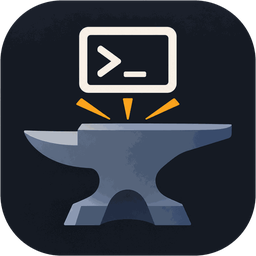

<div class="af-hero" markdown>

{ .af-hero__logo }

<div markdown>

# App<span>Forge</span>

<p class="af-hero__lead">
Forja tu equipo a partir de recetas. Cada aplicación con configuración propia
—una VPN, un servidor de modelos, tu entorno de desarrollo— se convierte en un
fichero TOML que puedes revisar, repetir y deshacer desde un único menú.
</p>

<div class="af-hero__actions" markdown>
[Empezar](guia/primeros-pasos.md){ .md-button .md-button--primary }
[Crear una receta](desarrollo/nueva-entrada.md){ .md-button }
</div>

</div>

</div>

<figure class="af-shot" markdown>

<figcaption>El catálogo: marca varias recetas, revisa su ficha e instálalas de una vez.</figcaption>
</figure>

## Por qué AppForge

Instalar algo «a tu manera» suele acabar en una nota con veinte comandos, un
fichero de configuración retocado a mano y la duda de si lo hiciste igual la
última vez. AppForge convierte esa nota en una **receta**: un fichero que dice qué
preguntar, qué ejecutar y cómo comprobar que quedó bien.

<div class="grid cards" markdown>

- :lucide-list-checks:{ .lg } **Siempre sabes qué está aplicado**

    Cada receta trae su propia comprobación. El catálogo marca con _aplicada_ lo
    que ya está en tu sistema; no hay ficheros de estado que se desincronicen.

- :lucide-eye:{ .lg } **Mira antes de tocar**

    El _dry-run_ enseña cada comando y el diff de cada fichero que se va a
    escribir. Nada cambia hasta que confirmas.

- :lucide-shield-check:{ .lg } **Seguro por defecto**

    Secretos enmascarados, copia `.backup` antes de sobrescribir y recetas
    rechazadas si alguien más puede editarlas.

- :lucide-layers:{ .lg } **Por lotes y cancelable**

    Marca varias recetas e instálalas seguidas, con progreso, registro en vivo
    y `ctrl+c` que corta de verdad el comando en curso.

- :lucide-file-code:{ .lg } **Recetas legibles**

    TOML con cuatro tipos de paso (`run`, `script`, `template`, `copy`). Sin
    condicionales ni bucles: si cabe en una nota, cabe en una receta.

- :lucide-package:{ .lg } **Un solo binario**

    Copia la carpeta con el binario, `config.toml` y tus recetas a otro equipo y
    funciona igual. `appforge validate` revisa las recetas en tu CI.

</div>

## Cómo funciona

=== "1. Escribe la receta"

    ```toml title="appforge-entries/ssh-server.toml"
    name = "Servidor SSH (endurecido)"
    description = "OpenSSH con acceso solo para tu usuario, sin root y, por defecto, solo con claves"
    category = "Red"
    details = """…"""            # la ficha completa, en Markdown

    [[param]]                     # se preguntan antes de aplicar
    name = "port"
    prompt = "Puerto de escucha"
    default = "22"

    [[param]]
    name = "password_auth"
    prompt = "¿Permitir contraseña? (no | yes)"
    default = "no"

    [check]                       # ¿ya está aplicada? (solo lectura)
    run = """
    conf=/etc/ssh/sshd_config.d/50-appforge.conf
    systemctl is-active --quiet ssh && grep -qx 'PermitRootLogin no' "$conf"
    """

    [[step]]                      # script: ssh-server/preflight.sh
    title = "Comprobaciones previas (parámetros, claves autorizadas)"
    script = "preflight.sh"

    [[step]]
    title = "Instalar OpenSSH"
    run = "DEBIAN_FRONTEND=noninteractive apt-get install -y openssh-server"

    [[step]]                      # plantilla con $port, $password_auth, $APPFORGE_USER
    title = "Endurecimiento en sshd_config.d"
    template = "50-appforge.conf.tpl"
    dest = "/etc/ssh/sshd_config.d/50-appforge.conf"
    mode = "0644"

    [[step]]
    title = "Validar (sshd -t), abrir el puerto en ufw y recargar"
    script = "apply.sh"

    [remove]                      # desinstalar
    run = """
    rm -f /etc/ssh/sshd_config.d/50-appforge.conf
    if systemctl is-active --quiet ssh; then sshd -t && systemctl reload ssh; fi
    """
    ```

    Versión abreviada de la [receta incluida](guia/recetas.md); sus ficheros viven en
    `appforge-entries/ssh-server/`.

=== "2. Revísala"

    <figure class="af-shot" markdown>
    
    <figcaption>Doble clic (o <kbd>v</kbd>) abre la ficha completa: descripción, parámetros, cada paso y su comprobación.</figcaption>
    </figure>

=== "3. Aplícala"

    <figure class="af-shot" markdown>
    
    <figcaption>Primero en <em>dry-run</em> (<kbd>d</kbd>): cada comando y el diff de cada fichero, sin tocar nada. Después, <kbd>i</kbd> instala.</figcaption>
    </figure>
